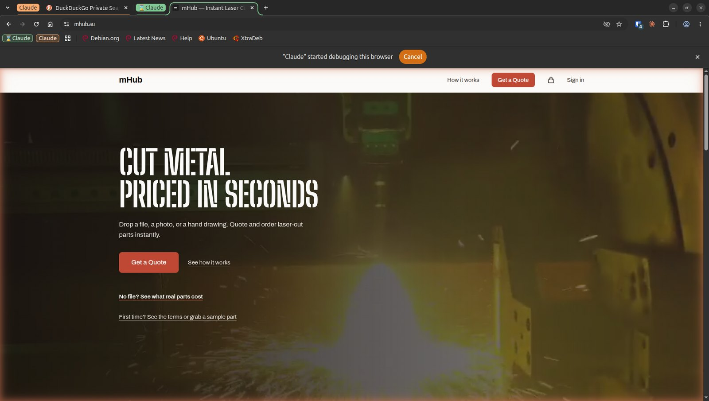
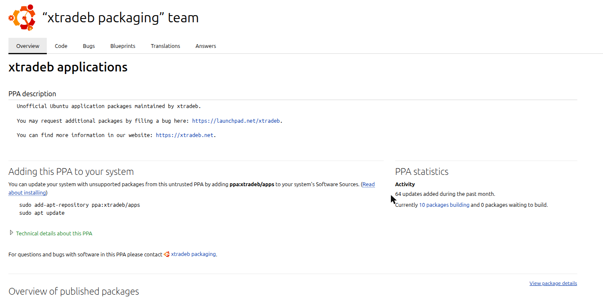
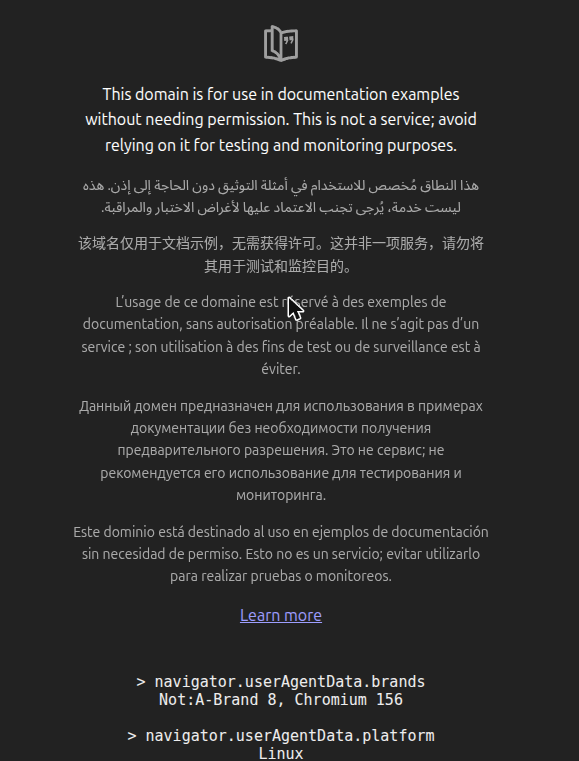

Firefox is my browser. It's where I'm signed into my own accounts. The Claude browser extension is built for Chrome-family browsers, and I wouldn't want it in my personal browser anyway. So I installed Chromium, the open-source browser Chrome is built from, purely for Claude. The extension installs into it from the Chrome Web Store like any other extension, and Claude Code drives it the same way it would drive Chrome.

This morning it took longer than it should have to get that working on my laptop, even though it has worked on my desktop since September. This post is what I learnt, so the next person (or the next Claude session) doesn't repeat it.

## Why I want Claude in a real browser

Most of what I build is a web app, and unit tests only get you so far. When Claude Code finishes a change, I want it to check the change the way a person would see it: open the page, upload a file, pick a material, read the price on screen.

This morning I shipped a security fix to [mHub](https://mhub.au), my manufacturing quoting site. After the deploy, Claude used the extension to upload a part on the quote page in my browser and check that it still priced to the cent. It then filled in a sign-up form and clicked "Create account with passkey". The only thing I did was complete the passkey prompt when it came up. That split suits me: the agent does the clicking and the reading, and I'm there for the step that needs a human.



Doing this in a real browser, rather than a headless one, also means I can watch it work, in its own tab group, and stop it if it wanders. Chromium makes it obvious: a bar across the top says "Claude" started debugging this browser, with a Cancel button, and the page Claude is driving gets an orange glow around its edge.

## Why a separate browser

The extension can read and act in the pages it opens, using whatever that browser is signed into. Every page it reads is also input to the model, and a page can contain text written to steer an agent. In Firefox that would put my personal accounts within reach. In Chromium, the only things signed in are the test accounts I give it for the sites I'm building. If something goes wrong, the damage is limited to what that browser can reach, and that's very little.

It's the same instinct as running a service in its own container: give the agent its own space and keep it small.

## Gotcha 1: Claude kept reaching for Chrome

Claude Code calls the feature "Claude in Chrome", and the skill it loads assumes Google Chrome. When the browser tools weren't connected, Claude's first move was to load that skill, which ends in a prompt to install the extension in Chrome. I don't use Chrome for this. I declined it, and then had to explain again that I meant Chromium.

The fix on the Claude side was to save a memory: check whether the browser tools are actually listed before doing anything, and if they aren't, say so in one line and ask me to connect Chromium, rather than offering Chrome. If you use Chromium, it's worth putting a line like that in your `CLAUDE.md`.

## Gotcha 2: the snap version of Chromium

The real reason it worked on one machine and not the other was how Chromium was installed:

| | Desktop | Laptop (before) |
|---|---|---|
| Chromium | deb package from the xtradeb PPA | Ubuntu's snap |
| Native host manifest | present | missing |
| Extension | installed | installed |

The extension talks to Claude Code through Chromium's [native messaging](https://developer.chrome.com/docs/extensions/develop/concepts/native-messaging): a small manifest file tells the browser which program to start when the extension wants to reach Claude Code. On my laptop that manifest didn't exist at all.

Even with the manifest in place, the snap would have been a problem. The snap version of Chromium looks for native host manifests under `~/snap/chromium/common/` rather than `~/.config/chromium/`, and it runs inside snap's sandbox. As far as I can tell that sandbox can't reach hidden folders in your home directory, which is exactly where Claude Code keeps its native host wrapper (`~/.claude/chrome/`) and where its binary lives (`~/.local/bin/claude`).

I've been bitten by snaps before, [with Bitcoin Core](/posts/dont-snap-install-bitcoin-core/). This one only cost me a morning.

## The setup that works

**1. Install Chromium as a deb, not a snap.** Ubuntu itself only ships Chromium as a snap; even the `chromium-browser` deb in Ubuntu's archive just installs the snap. The xtradeb PPA builds a real deb, and it's what my desktop already used.



Note that the PPA describes itself as unofficial and untrusted: you're trusting its maintainers with your browser. That was already the case on my desktop, so it wasn't a new trade-off for me.

```bash
sudo snap remove chromium
sudo add-apt-repository -y ppa:xtradeb/apps
sudo apt install -y chromium
```

Removing the snap takes your Chromium profile with it, extensions included. Snap also saves a compressed snapshot of the app's data on the way out, which is why my laptop's fan spun up during `snap remove`. Expect to sign into things again.

Check where it came from afterwards:

```bash
apt-cache policy chromium
```

It should show the `ppa.launchpadcontent.net/xtradeb/apps` source, and `snap list chromium` should say there's no snap.

**2. Install the Claude extension** in the new Chromium and sign in.

**3. Make sure the native host is registered.** These are the two files Claude Code wrote on my desktop. On my laptop it didn't write them, so I copied them across. The manifest goes in `~/.config/chromium/NativeMessagingHosts/com.anthropic.claude_code_browser_extension.json`:

```json
{
  "name": "com.anthropic.claude_code_browser_extension",
  "description": "Claude Code Browser Extension Native Host",
  "path": "/home/YOU/.claude/chrome/chrome-native-host",
  "type": "stdio",
  "allowed_origins": [
    "chrome-extension://fcoeoabgfenejglbffodgkkbkcdhcgfn/"
  ]
}
```

And the wrapper it points to, `~/.claude/chrome/chrome-native-host`, made executable:

```sh
#!/bin/sh
exec /home/YOU/.local/bin/claude --chrome-native-host
```

Replace `YOU` with your username and check that `which claude` matches the path. The `allowed_origins` ID is the Claude extension's ID; if yours differs, it's on `chrome://extensions` with developer mode on.

**4. Restart Chromium, then reconnect Claude Code.** Chromium only reads the manifest when the extension starts, and a Claude Code session that started without the browser tools didn't pick them up later. After restarting Chromium and reconnecting the session, the tools appeared.

**5. Check it's really Chromium.** I had Claude run one line of JavaScript in the tab it controls:



Chrome would report a "Google Chrome" brand there. This one says Chromium 156, the deb I'd just installed.

## One more thing to repoint

If you also use the Playwright MCP server with `--executable-path /snap/bin/chromium`, that path is gone once the snap is. I repointed mine at `/usr/bin/chromium`. Its profile directory lived under `~/snap/chromium/common/` as well, so that went with the snap too.

## Was it worth it?

Yes. Having the agent check its own work in a real browser, one that holds nothing of mine, with me stepping in only for the passkey, is the bit of agentic coding that has made me trust the results most. It just needed the boring plumbing to be right first: a deb instead of a snap, and two small files.
