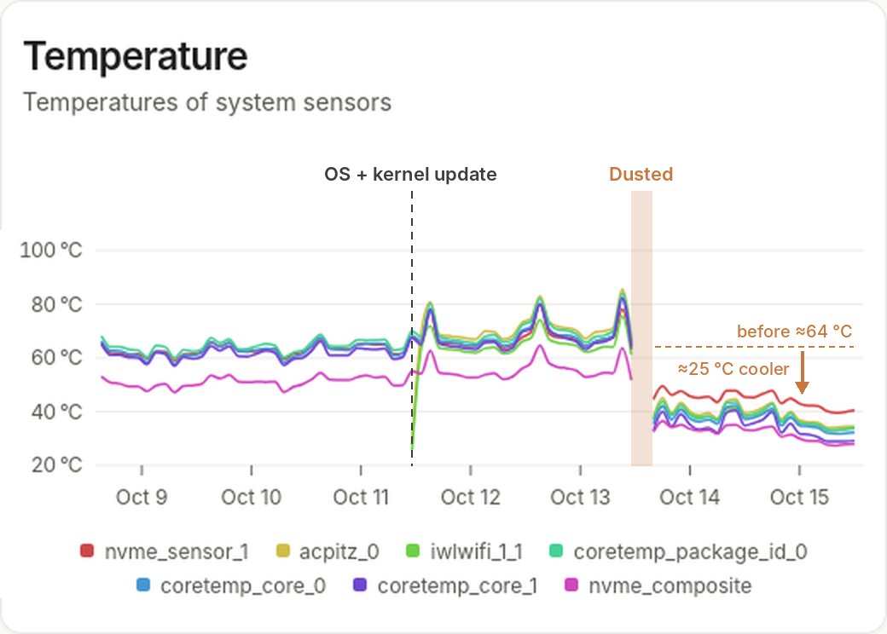

Over a few months, my wife and I had both noticed that my primary home server and my desktop machine were getting very noisy. The server was the big offender, being located at the edge of the living room. Its fan was whirring hard all of the time and revving up periodically. I'd granted this machine extra RAM a few months ago and I had trimmed some unused services on it to no avail. It turned out the fix was much simpler, and a new monitoring tool is what pointed me to it.

The server is an Intel NUC11TNKi3, the slim model with an i3-1115G4 and 24 GB of RAM. It runs a lot: around 60 containers including [Immich](https://immich.app), a Lightning node and GitHub runners. My desktop is an older NUC8i5BEK.

## Finding Beszel

I had [Cockpit](https://cockpit-project.org) installed on a couple of servers that I run at home. While updating these, I noticed that, as usual, some parts of Cockpit were playing up. I rarely used this application anyway and figured that it was simplest to remove it from both. I wondered if there was a better alternative to it for what I wanted to do. Namely, analyse the performance of my servers and be alerted if there were problems. This turned up [Beszel](https://beszel.dev).

I installed the hub of Beszel on my primary server and agents on my secondary, a couple of desktops and my laptop. Beszel supports OIDC access, which is nice, and I further secure it behind another layer of OIDC (with [Pocket ID](https://pocket-id.org)) so that, like other self-hosted services, not even the login page is available publicly.

The presentation of Beszel is clean and attractive. I find myself checking it from my phone often to see how the machines are faring, and notice trends.

## What the data showed

I watched the stream of data from the primary server closely for a few days. I've moved some intermittent workloads to it (GitHub runners) and it has a few other jobs that are somewhat taxing such as Immich indexing and [Restic](https://restic.net) backups. Beszel revealed that, in addition to running hot at quiet times (~10% CPU), it would rocket to 100 °C if any work arrived and its power was throttled automatically for self-preservation. Clearly something was wrong.

The giveaway was the idle figure. The CPU sat at 60–63 °C while drawing about 3 W. That's far too hot for 3 W, which points to poor heat transfer rather than too much work. The NVMe drive had also logged over six hours above its warning temperature in its lifetime.

## The fix

Claude suggested replacing the thermal paste and cleaning away dust as the most helpful first steps. I started with disassembly and dusting: I blew the dust out and wiped the surfaces down with isopropyl alcohol. That alone seems to have done the trick, so I didn't need to touch the thermal paste. There was a bit of dust but nothing like what old desktops used to collect without complaint. Of course, these little NUCs are very compact and so very sensitive to impediments to airflow. The server was off for about an hour and a half.

Here's the temperature graph across the past week for the primary server. You can see that the sensors hovered around 60 to 65 °C before the maintenance. After that, they dropped to about 35 to 40 °C. Because of smoothing, you can't see the numerous spikes to 100 °C in the former period either. Beszel's alerts show them instead: 13 over-90 °C temperature alerts in five days, and none since the clean.

The dashed line marks an OS and kernel update, after which the `iwlwifi_1_1` (Wi-Fi) sensor started reporting. The shaded gap is the downtime while I had it apart.

The nightly Restic backup makes a fair like-for-like comparison, since it's the same job at the same time each night:

| | Before | After |
|---|---|---|
| CPU at idle (~10% CPU) | 60–68 °C | 36–38 °C |
| CPU during nightly Restic backup | 65–68 °C | 37–38 °C |
| CPU during daily load bursts | 80–84 °C | 42–47 °C |
| NVMe drive | 47–58 °C | 32–37 °C |
| CPU throttling | ~24 minutes over two days | none |

The servers are now nearly inaudible.

## Routine maintenance

I had a similar result for cleaning my desktop NUC. The secondary server, an old NUC5CPYH with a Celeron N3060, doesn't run anything taxing, pretty much just bitcoind, so its improvement was less marked but still, I felt, worth doing. Now, I'll build a teardown and clean into the routine maintenance for compact machines like these. Maybe every two years will be sufficient, unless a metric like these on Beszel prompts me to act sooner.

If you have a compact machine that's getting noisy and slow, consider cleaning it before you renovate it or replace it. It could save you time, money and reduce waste. And if you're interested in maintaining a small fleet, Beszel is easy to set up and beautiful. Checking it might replace your instinct to check Nostr or do a Wordle, at least for a while.
