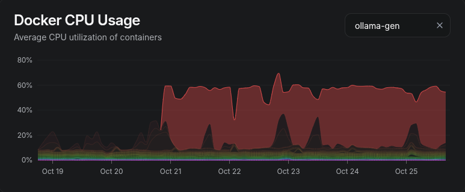
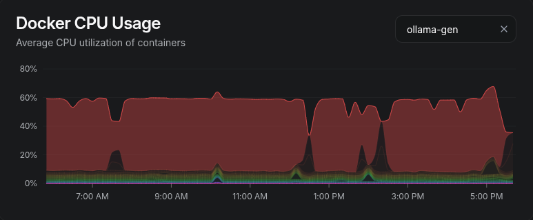

My home server does two jobs that don't get along. It runs a small local LLM that grinds through background work, and it runs the GitHub Actions jobs for a side project. When both were busy at once, CI got 40–95% slower. The fix that worked was blunt: freeze the model whenever a CI job is running.

## How two workloads ended up on one box

The server is a small mini PC with an i3-1115G4 (two physical cores, four threads) with 24 GB of RAM. It already runs most of my household's services.

Earlier this month a side project burned through GitHub's free Actions allowance (2,000 minutes) in twelve days, and jobs stopped starting. Self-hosted runners don't use up minutes, so I put two runners on the server, each capped at 2 CPUs and 4 GB. The first green run took four minutes wall-clock, and the load average peaked around 3. Fine.

A week later I gave the same box a local LLM. It's Ollama running Qwen3, the 8B model for bulk passes and the 14B for final judgement. It does work nobody waits on: tidying near-duplicate notes in my memory store, and writing a morning summary of the server's logs. It's not fast (about 2.7 tokens/second generating on the 8B), but it doesn't need to be. It just needs to keep at it during idle time.

That "during idle time" turned out to be the problem.



*The week the model moved in. That 60% plateau is one container, and on a four-thread machine it's most of the box.*

## Measuring it

CI felt slower, so I pulled per-job timings from the GitHub API, using each job's own `started_at`/`completed_at` rather than the run's wall time, which includes queueing.

| Job | Model idle | Model generating |
|---|---|---|
| test | 3.3–3.5 min | 4.9 min |
| lint | 1.8–2.1 min | 3.5 min |
| typecheck | 1.9–2.1 min | 3.1 min |

That's 40–95% slower, with lint hit hardest.

I also got a control group by accident. One afternoon the worker was held off for an hour by an unrelated job, and CI times during that hour went straight back to the "idle" column. So it wasn't my imagination, and it wasn't the runners themselves.
## Why `cpu_shares` doesn't save you

The obvious fix is to tell the scheduler who matters more. Both containers already had `cpu_shares: 256`, so I could have dropped the model to 64 and called it done.

It wouldn't have worked, and the reason is the bit I find most interesting. Shares are a weighting for the scheduler: they decide who gets the next time slice when threads compete for the same logical CPU. But on a two-core chip with hyperthreading, the four "CPUs" are really two cores split in half. LLM inference is dense AVX-512 matrix maths, and it keeps a core's vector units and memory bandwidth saturated. A CI job on the other hyperthread of the same core is technically "running", but it's sharing the hardware with something that eats everything.

The scheduler can't help with that. It can only decide who runs, not how much of the core a thread gets while it's running. On a box with lots of cores you'd pin them apart with `cpuset` and move on. With two cores, there's nowhere to put them.

So the model can't coexist with CI. It has to stop.

## Freezing the model

`docker pause` uses the kernel's cgroup freezer. The container's processes stop being scheduled at all. They aren't killed, and they don't get a signal they could mishandle. Memory stays where it was. When you `docker unpause`, they carry on mid-instruction.

For a model halfway through a generation, that's exactly what I want. The only risk is that whatever is waiting on the HTTP response gives up. My worker's request timeout is 12 hours, so a frozen generation just looks like a slow one.

The watcher is a small bash loop run by a systemd service. Every ten seconds it asks one question: is a CI job running right now? If so, it pauses the model. When CI has been quiet for two minutes, it unpauses it.

```bash
TARGET=ollama-gen
POLL_SECS=10
QUIET_SECS=120

ci_busy() { pgrep -x Runner.Worker >/dev/null; }
state()   { docker inspect -f "{{.State.Paused}}" "$TARGET" 2>/dev/null; }
thaw()    { [ "$(state)" = true ] && docker unpause "$TARGET" >/dev/null && echo "thawed ($1)"; }
trap "thaw stopping; exit 0" TERM INT

last_busy=0
while true; do
  now=$(date +%s)
  if ci_busy; then
    last_busy=$now
    [ "$(state)" = false ] && docker pause "$TARGET" >/dev/null && echo "CI job running: paused"
  elif [ $((now - last_busy)) -ge "$QUIET_SECS" ]; then
    thaw "CI quiet"
  fi
  sleep "$POLL_SECS" & wait $!
done
```

The signal is `Runner.Worker`. The GitHub runner keeps a long-lived listener process running the whole time, but it only spawns a `Runner.Worker` while it's actually executing a job. So that process existing means "someone is waiting on this box".

The two-minute quiet period stops the model thrashing between jobs in the same run, or between a push and the follow-up push that fixes the typo.

The systemd unit has one line I'd insist on:

```ini
ExecStopPost=-/usr/bin/docker unpause ollama-gen
```

If the watcher crashes, gets stopped, or the box is shutting down, the model gets thawed. The failure mode I really don't want is a model that stays frozen forever and nobody notices for a week.



*Twelve hours on a Sunday. Each notch in the model's plateau is a CI run, and the darker spikes inside them are the runners getting the CPU back. Beszel averages this view over ten-minute buckets, so a seven-minute pause shows up as a dent rather than a drop to zero.*

## The two leaks

The first version worked on the first test. Then it leaked twice in the same evening.

**`docker top` lies when dockerd is busy.** My first `ci_busy` asked Docker for the process list inside each runner container. During a heavy image build, dockerd was too busy to answer for about two minutes. The check came back empty, the watcher decided CI was quiet, and it thawed the model mid-job. The fix was to stop asking Docker. Container processes are ordinary processes in the host's process table, so `pgrep -x Runner.Worker` on the host sees them without going through dockerd at all.

**Deploys fought the watcher.** My deploy script holds a lock while it redeploys stacks, and the watcher deliberately stays thawed while the model's own stack is being redeployed, because Compose can't recreate a stack around a paused container. But the lock covered *every* stack, so during an 11-minute dependency-update deploy the model ran unfrozen alongside CI. Now the deploy script takes a separate, narrower lock only around the model's own redeploy.

Both bugs had the same shape: the watcher believed its view of the world was accurate, and it wasn't.

## Did it work?

Here are three days of jobs since the final fix: 67 runs, with the watcher pausing the model 43 times.

| Job | Model idle | Model generating | With the watcher |
|---|---|---|---|
| test | 3.3–3.5 min | 4.9 min | 3.8 min |
| lint | 1.8–2.1 min | 3.5 min | 2.3 min |
| typecheck | 1.9–2.1 min | 3.1 min | 2.2 min |

Medians, and not quite back to baseline. It won back roughly three-quarters of the lost time. I haven't chased the rest yet. Two runners share four threads with each other, and the box is still running everything else it runs. I'd rather say so than round it off.

The model barely notices. Its work comes in hours-long batches, and losing a few minutes per CI run doesn't change when the morning summary arrives.

## The general point

Two kinds of work were sharing that box. CI has a person waiting on it. The LLM's work is background chores nobody watches. Priority tools like `nice`, `cpu_shares` and `CPUWeight` assume both can progress at different speeds. On small hardware with a vector-heavy workload, they can't. Background work then has to actually yield: notice when something with a person waiting on it is running, stop completely, and pick up where it left off.

If you're running a local model on a mini PC alongside anything time-sensitive, it's worth measuring before you trust the scheduler.
